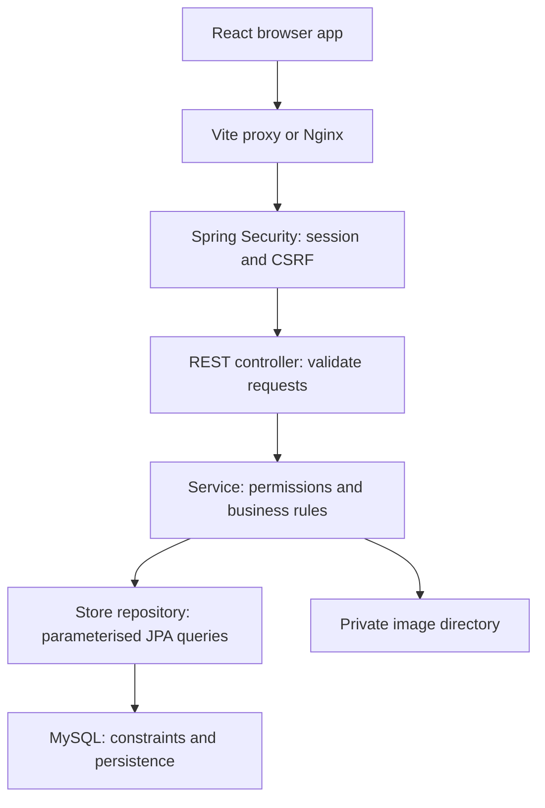
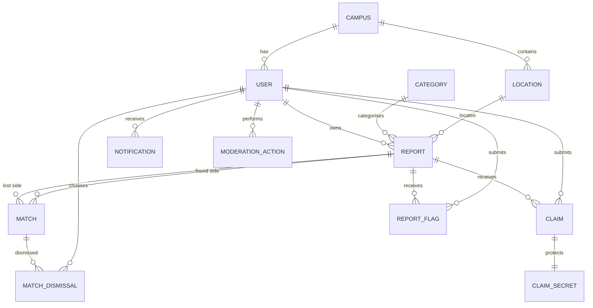
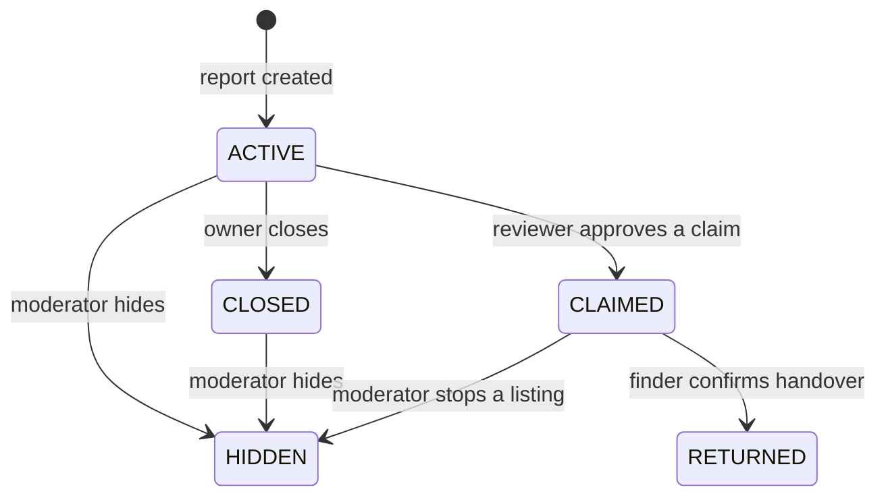
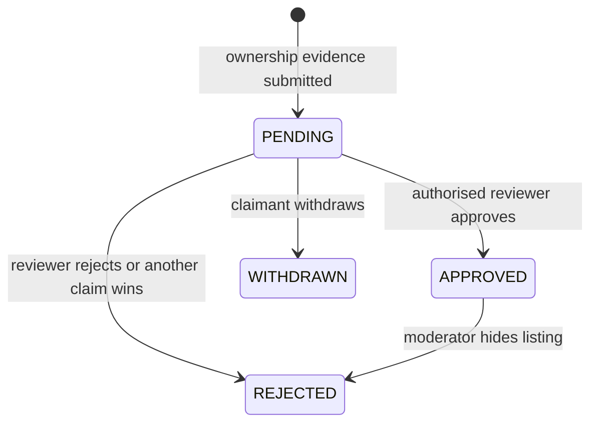

# How Foundly is organised

## Request flow

Think of a controller as the reception desk. It accepts a correctly shaped request. The service decides whether the action is allowed and applies the rules. The repository retrieves or saves the records. The database provides durable storage and another layer of constraints.

This is one backend application, rather than microservices. A small campus project benefits from simple deployment and transactions across reports, claims, notifications, and audits.

## Database relationships

Every core record has an auto-generated ID, a creation time, and an update time. Foreign keys connect users, campuses, locations, reports, claims, and matches. A unique lost/found pair prevents duplicate match rows. A unique report/claimant pair prevents repeated claims, including attempts to resubmit a rejected or withdrawn claim.

`claim_secrets` is deliberately separate. General report and claim DTOs have no field that could accidentally expose the verification text. A reviewer-specific endpoint checks permissions before reading that table. Images are files; the database stores only a generated image key.

## Authentication and campus membership

A session cookie is a reference to server-held authentication, rather than a bearer token kept in browser storage. Spring Security rotates the session on authentication. Mutating requests require a CSRF token tied to the session. React fetches a fresh token after login/logout.

The app reads the user’s current database role, campus, membership state, and suspension state for every service operation. Injecting a client-side role or hiding a React button cannot grant access. Public catalog and health endpoints reveal no private reports. All report browsing requires verified membership and is restricted to the account’s campus.

OPEN membership is a documented demo mode, not real identity verification. MANUAL membership requires human verification by a trusted campus administrator. Multi-campus relationships exist in the schema, but there is no self-service campus creation UI or automatic campus identity integration.

## Report and claim state transitions

A pending claim can be decided once. Approval locks the report, changes it to CLAIMED, rejects conflicting pending claims, stores the private handover plan, and emits notifications and audit rows in one transaction. The finder alone can confirm an approved handover. A second return request is rejected. Closing an active report rejects pending claims; moderation hiding rejects both pending and approved claims.

## Matching rules

The default score is a weighted sum normalised to 0–100:

| Factor   | Weight | Rule                                                                  |
| -------- | -----: | --------------------------------------------------------------------- |
| Category |     35 | Same category ID                                                      |
| Keywords |     25 | Jaccard overlap of title/description words longer than two characters |
| Colour   |     15 | Same nonblank colour, ignoring case                                   |
| Location |     15 | Same location ID                                                      |
| Date     |     10 | Linear decrease from same day to zero at 14 days apart                |

Pairs must be active, opposite-type reports on the same campus with different IDs. A score of 35 or more creates or refreshes a suggestion by default. Weights and threshold are configuration properties. A score is a similarity measure, **not a probability of ownership**. The service never approves a claim automatically.

Report writes lock the campus before changing reports and refreshing pairs. This simple approach avoids concurrent duplicate upserts, while a unique database constraint provides a final safeguard. It serialises writes and scans opposite active reports in that campus; a queue and better candidate indexing are the next steps at greater scale.

## Deliberate MVP trade-offs

`Store` is a small reusable JPA repository implemented with EntityManager. Queries are parameterised; services compose fixed query fragments, never executable SQL from user input. This keeps the initial project small, but dedicated Spring Data repositories and Specification-based report searching would be a useful teaching refactor.

Entity fields are directly accessible inside the backend, and workflow values are validated strings backed by request validation and database checks where defined. A further refactor should encapsulate entity methods and use typed Java enums throughout. Neither entities nor lazy relationships are directly serialized as API responses.

Sessions are in-process and images are on a mounted filesystem. A single backend instance is the supported initial deployment. See the deployment guide for the additional work needed for multiple instances.
